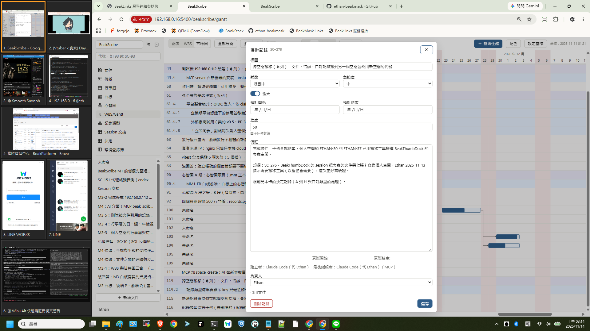

# BeakThumbDock

[English](README.md) | 日本語 | [繁體中文](README.zh-TW.md)

Windows 用のインストール不要のツールです。複数のウィンドウ（他の仮想デスクトップ上のウィンドウを含む）をライブサムネイルにして、画面の端のサムネイル領域に並べます。サムネイルをクリックすると、そのウィンドウが前面に出ます。サムネイルは常に画面に残るため、複数のウィンドウを同時に監視したり、多数のウィンドウをすばやく切り替えたりするのに向いています。

この文書と日本語の表示は機械翻訳をもとにした初稿で、ネイティブによる確認を受けていません。



スクリーンショットでは、サムネイル領域が左にドッキングされ、番号付きのスロットが 8 個並んでいます。各スロットには 1 つのウィンドウ（ブラウザー、ターミナル、動画、チャットなど）のライブ映像が表示されます。右側のブラウザーは、タスクバーの手前で止まるのと同じように、残りの領域いっぱいに最大化されています。スロット 4 をクリックするか `Alt+Shift+4` を押すと、そのウィンドウが同じ場所で前面に出ます。

- すべてのサムネイルは静止画ではなくライブ映像です。動画は再生され続け、ページもスロットの中で更新され続けます。Chrome と Edge は、他のウィンドウに隠れているときや他の仮想デスクトップにあるときもライブのままにするために、起動オプションが必要です（[マニュアルの 12 章](docs/manual.ja.md)を参照）
- サムネイル領域はタスクバーのように左・右・上・下にドッキングするか、画面全体を覆うサムネイルウォールにできます
- 1 画面、2 画面、複数の仮想デスクトップに対応
- ルールによってウィンドウを自動的に見つけ直すため、再起動後に設定し直す必要がありません
- 複数のレイアウト、グローバルホットキー、起動時のプログラム起動
- 表示言語：繁體中文、English、日本語、简体中文
- .NET ランタイムを内蔵した exe 1 つだけ：.NET のインストール不要、インストーラーなし、管理者権限不要、レジストリへの書き込みなし、ネットワーク接続なし

## 使い方

1. [`ThumbDock.exe` 0.11.6](https://github.com/ethan-beakmask/BeakThumbDock/releases/download/v0.11.6/ThumbDock.exe) をダウンロードします（約 52 MB、SHA256 `d2a0f3172d2089580d2ac64af83661dfaacf9a8aa43a9ebdaabe7631b4be7164`）。.NET ランタイムを内蔵しているため、.NET をインストールする必要はありません。他のバージョンは [Releases](../../releases) ページにあります。
2. 自分に書き込み権限のあるフォルダーに置いて実行します（設定とログは exe と同じ場所に保存されます）。
3. 空のスロットをクリックし、監視したいウィンドウにチェックを付けます。

実行ファイルの名前は `ThumbDock.exe` です。Windows 11 が必要です。Windows 10 では未確認です。

詳しい操作方法：[操作マニュアル](docs/manual.ja.md)（[Web ページ版](docs/manual.ja.html)）。

企業環境でエンドポイント保護ソフトウェアにブロックされる場合は、マニュアルの 16 章を参照してください。各リリースファイルの SHA256 ハッシュはリリースページに記載しています。

## ドキュメント

| 文書 | 内容 |
|---|---|
| [docs/manual.ja.md](docs/manual.ja.md) | 操作マニュアル |
| [docs/launch-config.ja.md](docs/launch-config.ja.md) | 起動設定ファイルの形式（起動時のプログラム起動） |
| [docs/translating.ja.md](docs/translating.ja.md) | 訳文の修正と言語の追加 |
| [THUMBDOCK_SPEC.md](THUMBDOCK_SPEC.md) | 当初の要件仕様（繁体字中国語） |

## 翻訳

日本語と簡体字中国語は機械翻訳の初稿で、ネイティブによる確認を受けていません。報告や修正を歓迎します。

- 言語ファイルは exe の隣の `config\lang\` に置くだけで使えます。再ビルドは不要です。
- レビュー用の表（CSV）は `docs/translations/` にあります。
- [docs/translating.ja.md](docs/translating.ja.md) を参照してください。

## ソースからビルドする

Windows と .NET 10 SDK が必要です。

```powershell
dotnet build ThumbDock.slnx
dotnet test ThumbDock.slnx
dotnet publish ThumbDock\ThumbDock.csproj -c Release -r win-x64 --self-contained true -p:PublishSingleFile=true -p:IncludeNativeLibrariesForSelfExtract=true -p:EnableCompressionInSingleFile=true -o publish\self-contained
```

SDK は、インストールも PATH の変更もせずに使えます。

```powershell
Invoke-WebRequest https://dot.net/v1/dotnet-install.ps1 -OutFile "$env:TEMP\dotnet-install.ps1"
& "$env:TEMP\dotnet-install.ps1" -Channel 10.0 -InstallDir "$env:LOCALAPPDATA\Microsoft\dotnet" -NoPath
& "$env:LOCALAPPDATA\Microsoft\dotnet\dotnet.exe" build ThumbDock.slnx
```

マニュアルの Web ページ版は、`python tools/build-manual.py` で Markdown ファイルから生成します。

## プロジェクト構成

| パス | 内容 |
|---|---|
| `ThumbDock/` | プログラム本体（`Native/`、`Core/`、`Layout/`、`UI/`、`Lang/`）と単体テスト |
| `tools/LangTool/` | 翻訳ファイルの保守ツール |
| `spike/` | 初期の技術検証プログラム。製品の一部ではありません |
| `docs/` | マニュアルと形式の説明 |

## ライセンス

[MIT](LICENSE)

## 作者

Ethan Yu（大E）
