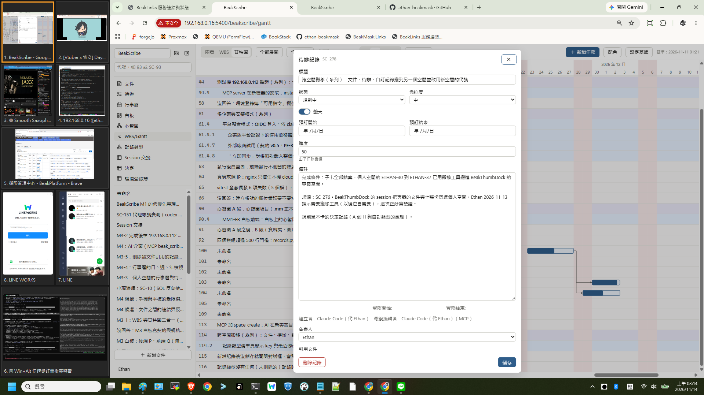

# BeakThumbDock

English | [日本語](README.ja.md) | [繁體中文](README.zh-TW.md)

A portable tool for Windows that turns several windows, including windows on other virtual desktops, into live thumbnails lined up in a thumbnail area at the edge of the screen. Click a thumbnail and that window comes to the front. The thumbnails stay on screen, which suits watching several windows at once or switching quickly among many windows.



In the screenshot, the thumbnail area is docked on the left with eight numbered slots. Each slot shows a live picture of one window: browsers, a terminal, a video, chat programs. The browser on the right is maximized into the remaining space, the same way a window stops at the taskbar. Clicking slot 4, or pressing `Alt+Shift+4`, brings that window to the front in its place.

- Every thumbnail is a live picture, not a snapshot: video keeps playing and pages keep updating inside the slot. Chrome and Edge need a startup flag to stay live while covered or on another virtual desktop; see [section 12 of the manual](docs/manual.en.md)
- The thumbnail area docks left, right, top or bottom like the taskbar, or covers the whole screen as a thumbnail wall
- Single monitor, dual monitor, and multiple virtual desktops
- Windows are found again by rule, so nothing has to be set up again after a reboot
- Multiple layouts, global hotkeys, and launching programs at startup
- Interface languages: 繁體中文, English, 日本語, 简体中文
- A single exe with the .NET runtime built in: no .NET installation, no installer, no administrator rights, no registry entries, no network access

## Getting started

1. Download [`ThumbDock.exe` 0.11.6](https://github.com/ethan-beakmask/BeakThumbDock/releases/download/v0.11.6/ThumbDock.exe) (about 52 MB, SHA256 `d2a0f3172d2089580d2ac64af83661dfaacf9a8aa43a9ebdaabe7631b4be7164`). It includes the .NET runtime, so .NET does not have to be installed. Other versions are on the [Releases](../../releases) page.
2. Put it in a folder you can write to (settings and logs are stored next to the exe) and run it.
3. Click an empty slot and tick the windows you want to watch.

The executable is named `ThumbDock.exe`. Windows 11 is required; Windows 10 has not been tested.

Full instructions: [User manual](docs/manual.en.md) ([web page version](docs/manual.en.html)).

If the program is blocked by endpoint protection software in a corporate environment, see section 16 of the manual. The SHA256 hash of each release file is listed on the release page.

## Documentation

| Document | Content |
|---|---|
| [docs/manual.en.md](docs/manual.en.md) | User manual |
| [docs/launch-config.en.md](docs/launch-config.en.md) | Launch config format (launching programs at startup) |
| [docs/translating.en.md](docs/translating.en.md) | Fixing a translation or adding a language |
| [THUMBDOCK_SPEC.md](THUMBDOCK_SPEC.md) | Original requirements specification (Traditional Chinese) |

## Translations

Japanese and Simplified Chinese are machine-translated first drafts that have not been reviewed by native speakers. Reports and corrections are welcome.

- A language file can be dropped into `config\lang\` next to the exe and used without rebuilding.
- Review spreadsheets (CSV) are in `docs/translations/`.
- See [docs/translating.en.md](docs/translating.en.md).

## Building from source

Requires the .NET 10 SDK on Windows.

```powershell
dotnet build ThumbDock.slnx
dotnet test ThumbDock.slnx
dotnet publish ThumbDock\ThumbDock.csproj -c Release -r win-x64 --self-contained true -p:PublishSingleFile=true -p:IncludeNativeLibrariesForSelfExtract=true -p:EnableCompressionInSingleFile=true -o publish\self-contained
```

The SDK can be used without installing it or changing PATH:

```powershell
Invoke-WebRequest https://dot.net/v1/dotnet-install.ps1 -OutFile "$env:TEMP\dotnet-install.ps1"
& "$env:TEMP\dotnet-install.ps1" -Channel 10.0 -InstallDir "$env:LOCALAPPDATA\Microsoft\dotnet" -NoPath
& "$env:LOCALAPPDATA\Microsoft\dotnet\dotnet.exe" build ThumbDock.slnx
```

The web page versions of the manual are generated from the Markdown files by `python tools/build-manual.py`.

## Project layout

| Path | Content |
|---|---|
| `ThumbDock/` | The program (`Native/`, `Core/`, `Layout/`, `UI/`, `Lang/`) and unit tests |
| `tools/LangTool/` | Maintenance tool for translation files |
| `spike/` | Early technical proof of concept; not part of the product |
| `docs/` | Manual and format documents |

## License

[MIT](LICENSE)

## Author

Ethan Yu (大E)
