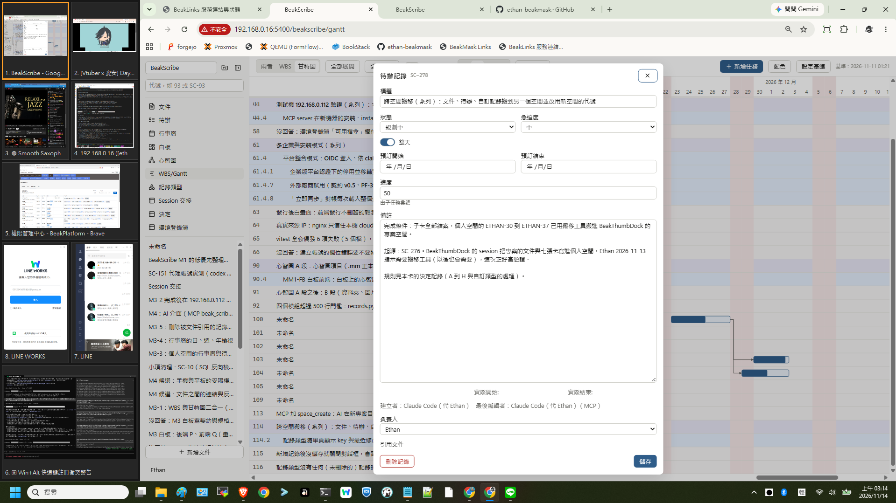

# BeakThumbDock

[English](README.md) | [日本語](README.ja.md) | 繁體中文

Windows 的免安裝小工具：把多個視窗（包含其他虛擬桌面上的視窗）變成即時縮圖，排在螢幕邊緣的縮圖區。點一下縮圖就把該視窗帶到前面，縮圖常駐，適合同時監看多個視窗或在大量視窗之間快速切換。



上圖中，縮圖區靠在螢幕左邊，有 8 個編號的槽位，每個槽位是一個視窗的即時畫面（瀏覽器、終端機、影片、通訊軟體）。右邊的瀏覽器最大化在剩下的空間裡，就像視窗會停在工作列前面一樣。點槽位 4，或按 `Alt+Shift+4`，那個視窗就會在同一個位置被帶到前面。

- 每個縮圖都是即時影像，不是靜態截圖：影片會繼續播放，網頁會在槽位裡持續更新。Chrome 與 Edge 被其他視窗蓋住或在其他虛擬桌面時，要加啟動參數才能保持即時，見[手冊第 12 節](docs/manual.md)
- 縮圖區可靠左／右／上／下，或蓋滿整個螢幕（縮圖牆）
- 單螢幕、雙螢幕、多個虛擬桌面
- 依規則自動找回視窗，重新開機後不必重新設定
- 多個佈局、全域快速鍵、啟動時自動開啟程式
- 介面語言：繁體中文、English、日本語、简体中文
- 單一 exe，已內含 .NET 執行環境：不必另外安裝 .NET、不需要安裝程式、不需要系統管理員權限、不寫登錄檔、不連網路

## 使用

下載 [`ThumbDock.exe` 0.11.6](https://github.com/ethan-beakmask/BeakThumbDock/releases/download/v0.11.6/ThumbDock.exe)（約 52 MB，SHA256 `d2a0f3172d2089580d2ac64af83661dfaacf9a8aa43a9ebdaabe7631b4be7164`），放進自己有寫入權限的資料夾後執行。這個檔案已內含 .NET 執行環境，不必另外安裝 .NET。其他版本在 [Releases](../../releases) 頁面。需要 Windows 11；Windows 10 沒有測試過。

操作說明見 [docs/manual.md](docs/manual.md)（網頁版：[docs/manual.html](docs/manual.html)）。

在公司環境被端點防護軟體攔截時，請見手冊第 16 節。每個發行檔的 SHA256 雜湊列在發行頁面。

## 翻譯

日文與簡體中文是機器翻譯的初稿，沒有經過母語者審閱，歡迎回報或提交修正。

- 新增語言或修正譯文的方法：[docs/i18n.md](docs/i18n.md)、[docs/i18n-translation-format.md](docs/i18n-translation-format.md)
- 審閱用的 CSV：`docs/translations/`
- 語言檔可以直接放進 exe 旁的 `config\lang\` 使用，不需要重新建置

## 從原始碼建置

需要 Windows 與 .NET 10 SDK（免安裝版的做法見 [docs/dotnet-sdk-portable.md](docs/dotnet-sdk-portable.md)）。

```powershell
dotnet build ThumbDock.slnx
dotnet test ThumbDock.slnx
dotnet publish ThumbDock\ThumbDock.csproj -c Release -r win-x64 --self-contained true -p:PublishSingleFile=true -p:IncludeNativeLibrariesForSelfExtract=true -p:EnableCompressionInSingleFile=true -o publish\self-contained
```

手冊的網頁版由 `python tools/build-manual.py` 從 `docs/manual*.md` 產生。

## 專案結構

| 路徑 | 內容 |
|---|---|
| `ThumbDock/` | 主程式（`Native/`、`Core/`、`Layout/`、`UI/`、`Lang/`）與單元測試 |
| `tools/LangTool/` | 翻譯檔維護工具 |
| `spike/` | 早期的技術驗證程式，不是正式程式 |
| `docs/` | 手冊與格式說明 |
| `THUMBDOCK_SPEC.md` | 原始需求規格 |

## 授權

[MIT](LICENSE)

## 作者

Ethan Yu（大E）
